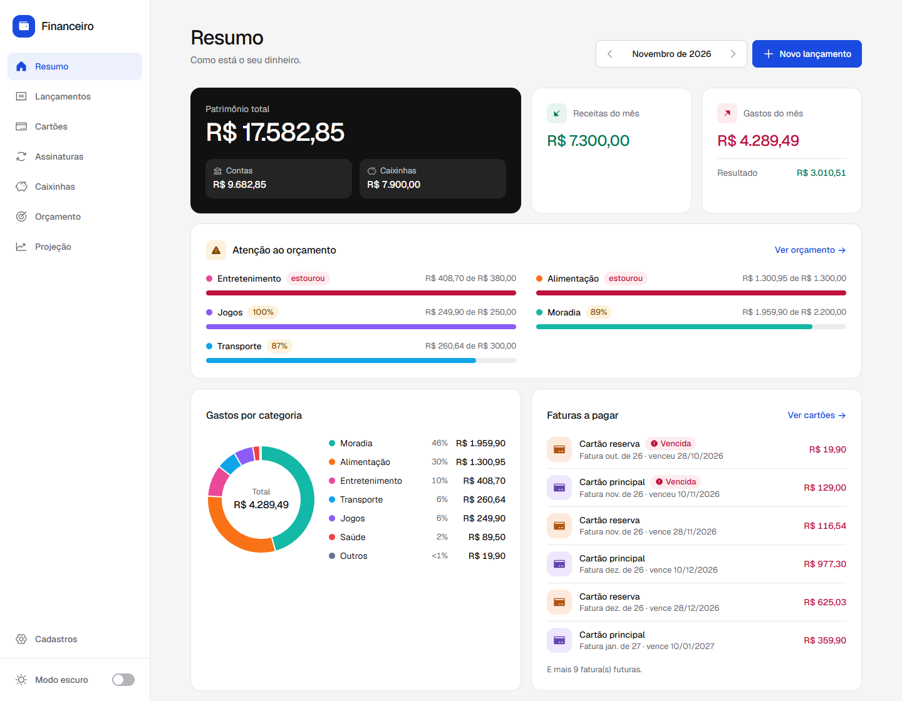
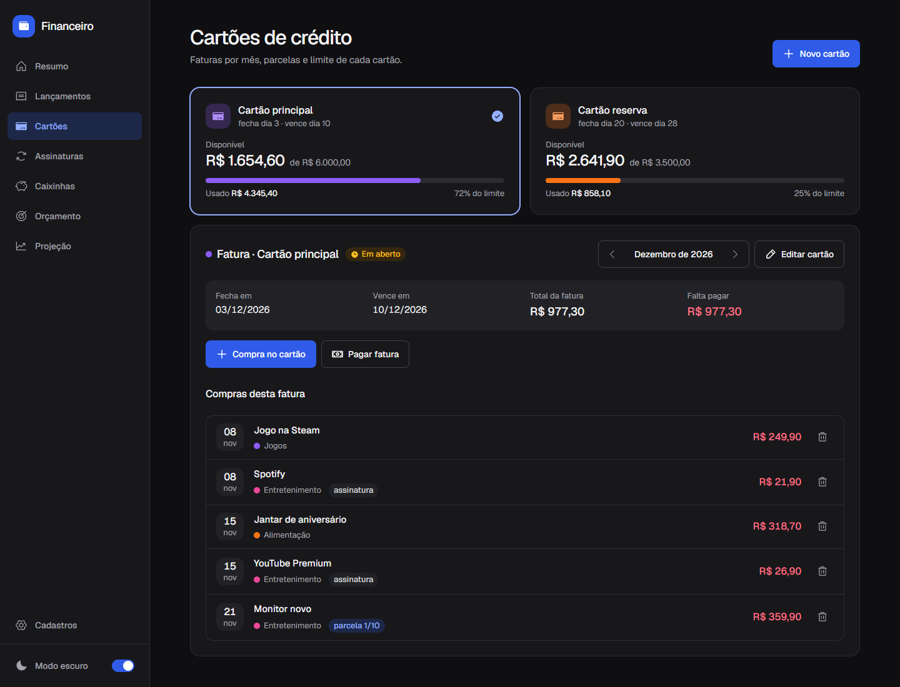

# Financeiro

Controle financeiro pessoal que roda **no seu próprio computador**: gastos e receitas, cartões de crédito com parcelas e faturas, assinaturas, caixinhas de economia, orçamento por categoria e projeção de saldo.

Não tem cadastro, login nem nuvem. Seus dados ficam em arquivos dentro da pasta do projeto.



<sub>Os dados das imagens são fictícios.</sub>

**Nesta página:** [O que dá para fazer](#o-que-dá-para-fazer) · [Instalação](#instalação) · [Primeiros passos](#primeiros-passos-no-app) · [Seus dados e backup](#seus-dados-e-backup) · [Atualizar](#como-atualizar) · [Problemas comuns](#problemas-comuns) · [Privacidade](#privacidade-e-segurança) · [Cálculos](#como-os-números-são-calculados) · [Para quem programa](#para-quem-programa)

## O que dá para fazer

| Tela | Para que serve |
| --- | --- |
| **Resumo** | Patrimônio, receitas e gastos do mês, alertas de orçamento, faturas a pagar (com aviso de vencida) e caixinhas. |
| **Lançamentos** | Registrar e filtrar gastos e receitas, na conta ou no cartão, à vista ou parcelado. |
| **Cartões** | Vários cartões, fatura de cada mês, limite usado e disponível, pagamento total ou parcial. |
| **Assinaturas** | Cobranças mensais no cartão (streaming, aplicativos…), com cancelamento e reativação. |
| **Caixinhas** | Objetivos de economia com meta e prazo. Guarde e resgate quando quiser. |
| **Orçamento** | Limite mensal por categoria, com aviso quando está perto ou quando estoura. |
| **Projeção** | Estimativa do saldo para os próximos 6, 12, 24 ou 36 meses. |
| **Cadastros** | Contas, categorias e recorrências, como salário e aluguel. |

Tem modo claro e modo escuro. O botão fica no pé do menu lateral e, em janelas estreitas, no topo.



## Instalação

Não é preciso saber programar. Os passos 1 a 3 são feitos **uma única vez**. Depois, para usar, basta o passo 4.

Você vai precisar de internet para instalar. Para usar, não.

### 1. Instale o Node.js

O Node.js é o programa que faz o app funcionar.

1. Baixe a **versão 24 ou mais nova** em [nodejs.org](https://nodejs.org).
2. Abra o arquivo baixado e instale com as opções padrão.

Para conferir se deu certo, abra um terminal (no Windows, aperte a tecla <kbd>Windows</kbd>, digite `cmd` e aperte <kbd>Enter</kbd>) e rode:

```bash
node -v
```

A resposta deve começar com `v24` ou um número maior.

### 2. Baixe o projeto

Escolha **uma** das opções:

- **Sem usar Git (mais simples):** no topo desta página, clique no botão verde **Code** e depois em **Download ZIP**. Extraia o arquivo numa pasta que você não vá apagar, como *Documentos*. O app não funciona de dentro do ZIP: é preciso extrair.
- **Com Git:**

  ```bash
  git clone https://github.com/theowari/financeiro.git
  ```

A pasta do projeto é a que contém o arquivo `package.json`. Pelo ZIP, ela se chama `financeiro-main`. Pelo Git, `financeiro`.

### 3. Instale os componentes do app

Abra um terminal **dentro da pasta do projeto**. No Windows:

1. Abra a pasta no Explorador de Arquivos.
2. Clique na barra de endereço, no alto da janela.
3. Digite `cmd` e aperte <kbd>Enter</kbd>.

Na janela que abrir, rode:

```bash
npm install
```

Espere terminar. Podem aparecer avisos com a palavra `warn`, inclusive um sobre o pacote `esbuild`: eles não impedem o app de funcionar. Se aparecer `error`, veja [Problemas comuns](#problemas-comuns).

### 4. Abra o app

**No Windows:** dê dois cliques no arquivo `iniciar.bat`, na pasta do projeto. Ele prepara o app, abre o navegador e liga o servidor.

- **Deixe a janela preta aberta** enquanto usa o app. Para encerrar, feche essa janela.
- Se o navegador abrir antes de o servidor ficar pronto e mostrar um erro, espere alguns segundos e atualize a página com <kbd>F5</kbd>.

**No macOS ou no Linux:** no terminal, dentro da pasta do projeto, rode:

```bash
npm run build
npm start
```

Depois, abra [http://localhost:3001](http://localhost:3001). Para encerrar, aperte <kbd>Ctrl</kbd> + <kbd>C</kbd> no terminal.

> **Dica para Windows:** para abrir o app pela Área de Trabalho, clique com o botão direito em `iniciar.bat`, escolha **Mostrar mais opções → Enviar para → Área de trabalho (criar atalho)**.

## Primeiros passos no app

O app já vem com uma conta (“Conta principal”) e algumas categorias. Uma boa ordem para começar:

1. **Cadastros → Contas:** edite a “Conta principal” e informe quanto há nela hoje (o saldo inicial).
2. **Cartões:** cadastre cada cartão com o limite, o dia de fechamento e o dia de vencimento.
3. **Lançamentos:** registre gastos e receitas. Em “Pago com”, escolha uma conta ou um cartão e, no cartão, o número de parcelas.
4. **Cadastros → Recorrências:** cadastre salário, aluguel e outros valores fixos da conta. Eles alimentam a projeção.
5. **Assinaturas:** cadastre o que é cobrado todo mês no cartão, sem número de parcelas.
6. **Orçamento** e **Caixinhas:** defina limites por categoria e objetivos de economia.

## Seus dados e backup

Na primeira vez que o app abre, ele cria a pasta `data`, dentro da pasta do projeto. Tudo o que você registra fica ali.

**Para fazer backup:**

1. Feche o app (a janela preta, ou <kbd>Ctrl</kbd> + <kbd>C</kbd>).
2. Copie a **pasta `data` inteira** para um lugar seguro.

> [!WARNING]
> **Não copie apenas o arquivo `financeiro.db`.** A pasta também pode ter os arquivos `financeiro.db-wal` e `financeiro.db-shm`, e o `-wal` pode guardar lançamentos que ainda não estão no `.db`, mesmo com o app fechado. Uma cópia só do `.db` pode ficar incompleta ou até vazia.

**Para restaurar:** com o app fechado, troque a pasta `data` atual pela cópia do backup. Troque a pasta inteira, sem misturar arquivos de cópias diferentes.

**Para começar do zero:** com o app fechado, renomeie a pasta `data` (assim você não perde nada). Na próxima abertura, o app cria uma nova.

## Como atualizar

Faça um [backup](#seus-dados-e-backup) antes. Na primeira abertura da versão nova, o app ajusta o banco de dados automaticamente.

**Se você baixou com Git**, feche o app e rode, na pasta do projeto:

```bash
git pull
npm install
```

Depois, abra o app como de costume.

**Se você baixou o ZIP:**

1. Feche o app.
2. Baixe o ZIP novo e extraia em **outra** pasta.
3. Copie a pasta `data` da versão antiga para dentro da pasta nova.
4. Na pasta nova, rode `npm install` e abra o app.
5. Confira seus dados antes de apagar a pasta antiga. Se você criou um atalho, refaça-o.

## Problemas comuns

| O que aparece | O que fazer |
| --- | --- |
| `'node' não é reconhecido…` ou `'npm' não é reconhecido…` | O Node.js não está instalado, ou o terminal foi aberto antes da instalação. Instale (passo 1), feche o terminal e abra de novo. |
| No PowerShell: *a execução de scripts foi desabilitada neste sistema* | Use o **Prompt de Comando** (`cmd`), como no passo 3. |
| *O build falhou*, com `'tsc'` não reconhecido | O passo 3 não foi feito nesta pasta. Rode `npm install`. |
| O navegador diz que não consegue acessar o site | Espere alguns segundos e aperte <kbd>F5</kbd>. Confira se a janela do servidor continua aberta. |
| Aparece *Financeiro rodando* e logo depois o servidor para (*O servidor parou.*) | Provavelmente a porta 3001 já está em uso, e a mensagem de sucesso aparece mesmo assim. Se o app já estiver aberto em outra janela, use aquela. Se for outro programa, [use outra porta](#usar-outra-porta). |
| Erros que citam `node:sqlite` ou a versão do Node | Rode `node -v`. Se for menor que 24, atualize o Node.js. |
| *Acesso permitido apenas via localhost* | Acesse por `http://localhost:3001`, no mesmo computador em que o app está rodando. |

### Usar outra porta

No Prompt de Comando do Windows:

```bat
set PORT=3002
npm run build
npm start
```

No macOS ou no Linux:

```bash
npm run build
PORT=3002 npm start
```

Depois, abra `http://localhost:3002`. O `iniciar.bat` sempre abre o navegador na porta 3001, por isso aqui o endereço é aberto manualmente.

## Privacidade e segurança

- O app não pede conta nem senha e não envia seus dados para a internet.
- O servidor só aceita conexões do próprio computador. Por isso, outros aparelhos da rede, como o celular, não conseguem acessá-lo.
- **Não exponha o app na internet** (com túnel, redirecionamento de porta ou hospedagem). Como não há login, quem chegasse até ele poderia ver e alterar tudo.
- O banco de dados **não é criptografado**. Quem tiver acesso aos seus arquivos consegue abri-lo.
- A pasta `data` está no `.gitignore`, para não ir junto em um commit.

## Como os números são calculados

- **Saldo da conta** = saldo inicial + receitas − gastos − faturas pagas − dinheiro guardado em caixinhas.
- **Patrimônio** = saldo das contas + valor nas caixinhas.
- **Fatura do cartão:** a compra feita até o dia de fechamento (inclusive) cai na fatura do mês; depois disso, na seguinte. A parcela *n* cai *n−1* meses depois. Pagar a fatura tira dinheiro da conta, mas **não** conta como novo gasto: o gasto já foi contado na compra.
- **Fatura vencida:** ainda tem valor a pagar e a data de vencimento já passou. No dia do vencimento ela ainda não conta como vencida.
- **Gasto por categoria (orçamento e resumo):** cada parcela de cartão conta no mês da própria parcela.
- **Limite usado** = tudo o que ainda falta pagar nas faturas, incluindo parcelas futuras.
- **Assinaturas:** no dia da cobrança, cada assinatura vira uma compra à vista na fatura do cartão (e entra no limite, no orçamento e nos lançamentos). Não há número de parcelas: a cobrança se repete todo mês até você **cancelar**. Cancelar mantém o histórico e pode ser desfeito com **Reativar**, sem cobrar os meses parados. Mudar o valor (reajuste) vale só para as próximas cobranças.
- **Projeção:** parte do saldo de hoje e soma as recorrências, as faturas pendentes (no mês do vencimento) e as próximas cobranças das assinaturas. Não inclui gastos variáveis que ainda não foram lançados.

## Para quem programa

Feito com TypeScript, React, Vite, Tailwind CSS, TanStack Query e Recharts no front; Express, Zod e SQLite (`node:sqlite`) no servidor.

```bash
npm run dev         # API na 3001 e front na 5173, com recarga automática: abra http://localhost:5173
npm test            # testes de domínio e da API (SQLite em memória)
npm run typecheck
npm run build       # checa os tipos e gera o front em dist/web
npm start           # serve o app compilado na porta 3001
```

| Variável | Padrão | Para que serve |
| --- | --- | --- |
| `PORT` | `3001` | Porta do servidor. No `npm run dev`, mantenha a 3001: o front encaminha a API para ela. |
| `FINANCEIRO_DB` | `data/financeiro.db` | Caminho do banco de dados. |

> [!TIP]
> O `npm run dev` usa o mesmo banco do uso normal. Para não misturar testes com seus dados reais, aponte `FINANCEIRO_DB` para outro arquivo.

```text
server/    API em Express; regras de negócio em server/domain/ e migrações em server/migrations/
web/       interface em React
shared/    tipos e funções de data usados pelos dois lados
```

Na interface:

- As cores, os botões e os campos são definidos em `web/src/index.css`. O tema escuro só troca os valores das variáveis de cor, então use as variáveis em vez de cores fixas.
- Os componentes compartilhados ficam em `web/src/components/ui.tsx`.
- A troca de tema, com a View Transition API, fica em `web/src/lib/theme.ts`. Em navegadores sem suporte, ou com “reduzir movimento” ativado no sistema, a troca é imediata.
- Os ícones são da [Phosphor](https://phosphoricons.com). Não usamos emojis na interface.

## Créditos

- Ícones: [Phosphor Icons](https://phosphoricons.com) (licença MIT).
- Fonte: [Geist](https://vercel.com/font) (SIL Open Font License 1.1), incluída no app.
